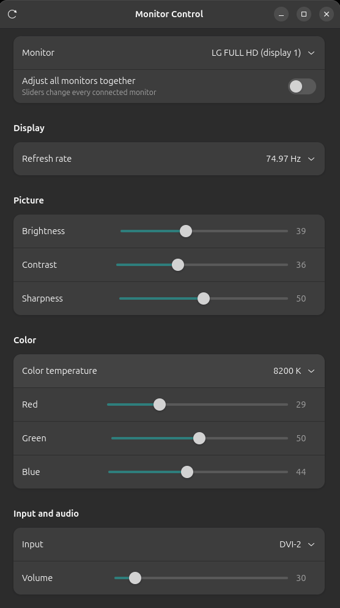

# Monitor Control for Ubuntu

Adjust your monitor's brightness, contrast, color and input from the Ubuntu desktop, without digging through the on-screen menu. It's a small, native-looking alternative to the control apps monitor makers ship only for Windows and macOS, such as LG OnScreen Control or Dell Display Manager.



It talks to the monitor over DDC/CI using [ddcutil](https://www.ddcutil.com/), so it works with most external monitors from any brand: LG, Dell, Samsung, ASUS, BenQ, HP, Lenovo, Acer, AOC, Philips, MSI, Gigabyte and others.

> This is an independent project. It is not made by or affiliated with any monitor manufacturer.

## Features

- **Refresh rate:** pick any refresh rate your monitor supports at its current resolution, with a 15-second "keep or revert" check
- **Picture:** brightness, contrast, sharpness
- **Color:** color temperature presets, and red, green and blue gain
- **Input and audio:** switch inputs (HDMI, DisplayPort, USB-C) and change the volume
- **Multiple monitors:** pick which monitor to adjust, or move all of them together

The app shows only the controls your monitor supports.

## Requirements

- Ubuntu 22.04 or newer (other GNOME-based distros with GTK 4 and libadwaita should work too)
- An external monitor with **DDC/CI turned on** in its on-screen menu (usually under General, Setup or System)

These can't be controlled with this app:

- Laptop built-in screens, which don't support DDC/CI
- Apple displays (Studio Display, Pro Display XDR), which are controlled over USB instead
- Monitors connected through some docks, DisplayLink adapters or daisy chains (DisplayPort MST), which often don't pass DDC/CI through

## Install

```bash
git clone https://github.com/SamiulSourav/monitor-control.git
cd monitor-control
chmod +x install.sh
./install.sh
```

The installer:

1. installs `ddcutil` and the GTK 4 / libadwaita Python bindings with `apt`
2. loads the `i2c-dev` kernel module and sets it to load on every boot
3. adds you to the `i2c` group so the app can talk to your monitor without `sudo`
4. installs the app to `~/.local/bin` and adds it to your app grid

**Log out and back in once after installing**, so the group change takes effect.

## Usage

Open **Monitor Control** from your app grid, or run `monitor-control` in a terminal.

## Updating

Download the new `monitor_control.py`, then run:

```bash
install -m755 monitor_control.py ~/.local/bin/monitor-control
```

## Troubleshooting

**"No controllable monitor found"**

- Check that DDC/CI is on in the monitor's on-screen menu. Some brands ship with it off.
- Make sure you logged out and back in after installing.
- Run `ddcutil detect` in a terminal. If it doesn't list your monitor, the app can't see it either.
- On the NVIDIA proprietary driver, DDC/CI can be unreliable. See the [ddcutil NVIDIA notes](https://www.ddcutil.com/nvidia/).

**A slider moves but nothing changes**

Many monitors lock brightness and contrast in some modes, such as HDR, dynamic contrast, auto brightness or eco/energy-saving modes. Turn those off in the monitor's menu. To check whether the monitor accepts changes at all, run:

```bash
ddcutil setvcp 10 30
```

**Switching input does nothing**

Some models, including several LG monitors, use non-standard codes for input switching. The other controls still work on these models.

**Seeing errors**

Start the app from a terminal with `monitor-control`. Any errors are printed there.

## Limitations

The refresh rate isn't a DDC/CI setting. The app changes it through GNOME's display settings (the same ones GNOME Settings uses), so this option only appears in a GNOME session.

Features that come from a monitor maker's own software, such as screen-splitting layouts, per-app picture modes and firmware updates, can't be controlled over DDC/CI.

## Uninstall

```bash
rm ~/.local/bin/monitor-control
rm ~/.local/share/applications/monitor-control.desktop
rm -r ~/.config/monitor-control
```

Optionally, undo the system changes:

```bash
sudo gpasswd -d "$USER" i2c
sudo rm /etc/modules-load.d/i2c-dev.conf
sudo apt remove ddcutil
```

## How it works

The app is a single Python file using GTK 4 and libadwaita. It calls `ddcutil` to read and write standard MCCS (VCP) features: `0x10` brightness, `0x12` contrast, `0x87` sharpness, `0x14` color preset, `0x16`/`0x18`/`0x1A` RGB gain, `0x60` input source and `0x62` volume. Slider changes are sent on a background thread and collapsed, so dragging stays smooth. The refresh rate list comes from Mutter's `org.gnome.Mutter.DisplayConfig` D-Bus service, matched to the ddcutil display by its connector and EDID.

## License

MIT
